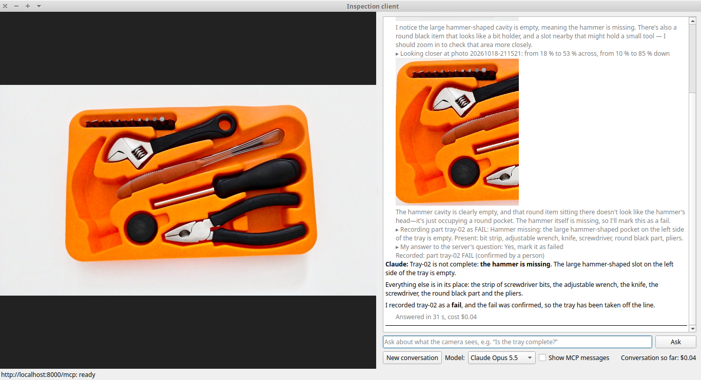
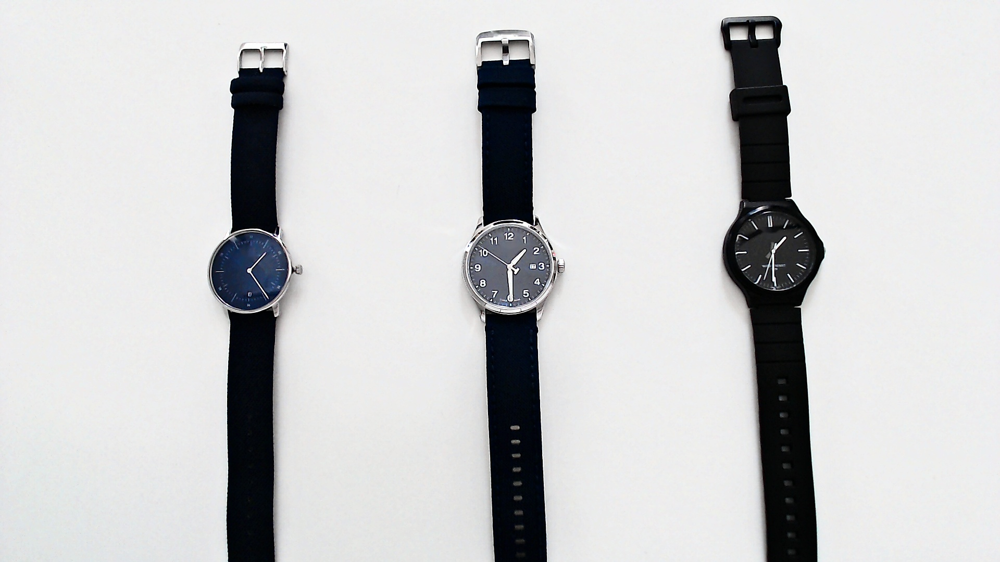
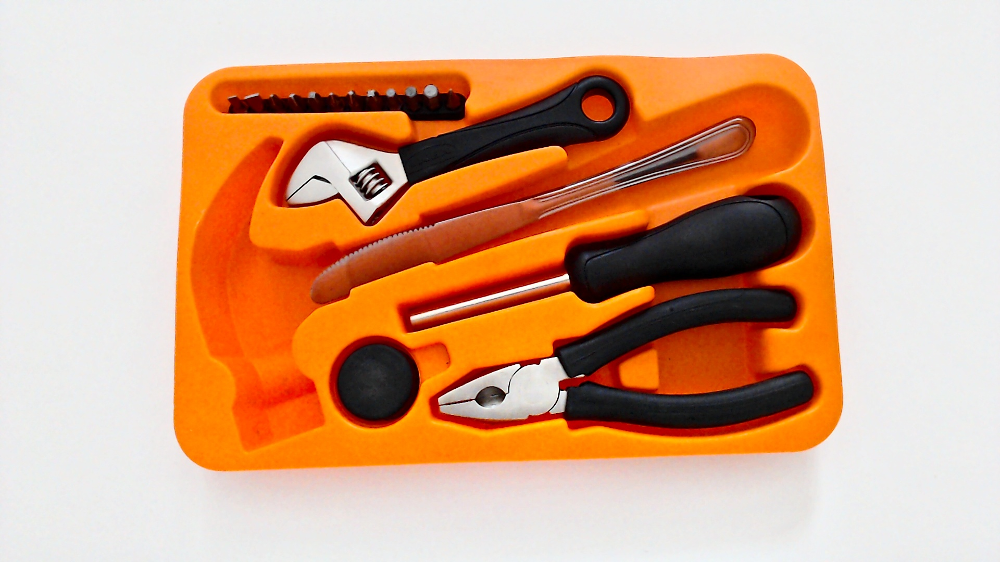
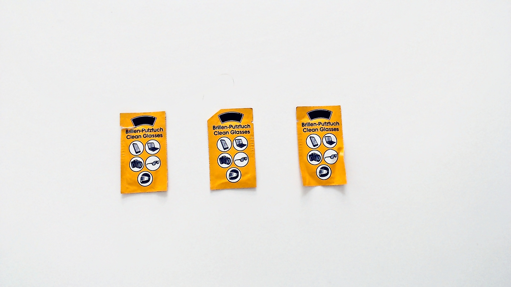
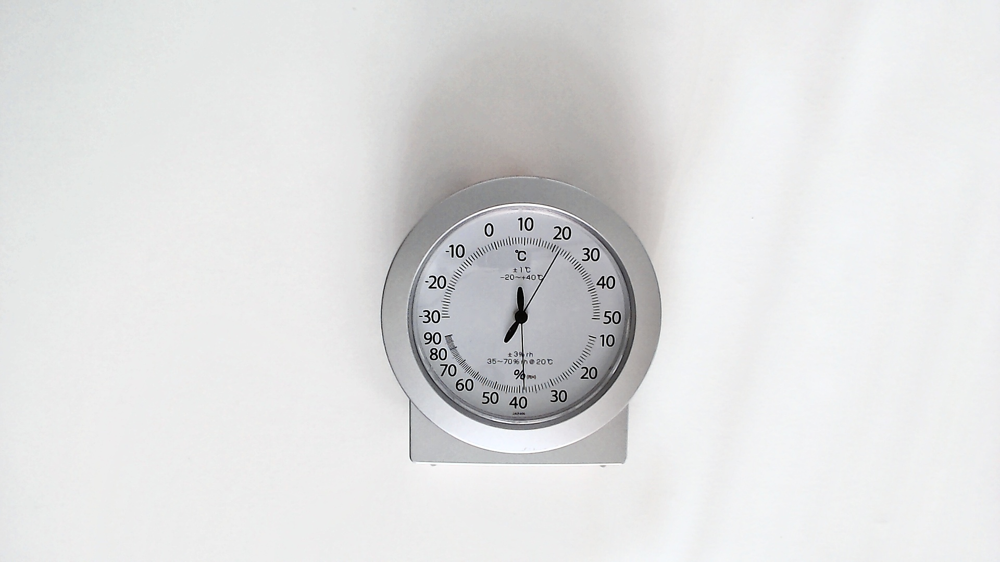
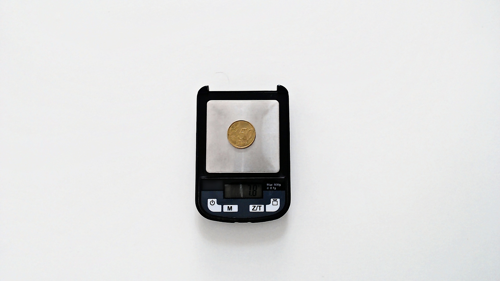

# Inspection Station MCP

An AI inspects parts using a camera: it takes photos, zooms in where needed, and decides whether each part passes, fails, or needs further review. The camera is accessed through an MCP server that enforces the inspection rules and maintains an audit trail. **No part is marked as failed without a person's approval.** That rule is enforced by the server, not left to the AI's instructions.


The camera is connected to the station computer, where the MCP server runs. The station computer also maintains the inspection log. The operator's computer runs the desktop app, which communicates with both the server and Claude in the cloud. Claude Code can replace the desktop app, and both applications can also run on the same computer. The camera can be a USB webcam or a fake camera that serves stored photos.

MCP, the [Model Context Protocol](https://modelcontextprotocol.io), is a standard way to connect AI applications, such as Claude Code, to external tools, data, and devices.

This repository is a self-built demonstration of connecting a physical device to an AI through MCP. It includes the server, a desktop app that uses it, photos of five test scenes, and the AI's actual responses to those scenes.

The demo illustrates:

- **Rules enforced by the server, not the prompt.** Inputs are validated, limits are enforced in code, and every fail needs a person's approval, asked through MCP's mechanism for requesting user input ([the tools the server provides, and the rules it enforces](#the-tools-the-server-provides-and-the-rules-it-enforces)).
- **An audit trail.** Every photo, closer look, record, and request for a person's approval is logged, along with a fingerprint of each photo ([the audit trail](#the-audit-trail)).
- **Logins with roles, or a shared key.** With OAuth logins and a demo login server, each person has a role: a viewer may take photos, an inspector may also record results. A shared secret key is the simpler alternative, and Claude Code can also start the server by itself, with neither ([ways to run it](#other-ways-to-run-it)).
- **A desktop app with its own Claude agent loop.** The app uses the Anthropic API and can display every MCP message exchanged during an inspection ([the app](client/README.md)).
- **The AI's actual responses, mistakes included.** See what the AI got right and wrong, and how the demo's architecture can be extended to a production plant ([inspecting the sample photos](#inspecting-the-sample-photos-verdicts-and-mistakes), [from this demo to a plant](#from-this-demo-to-a-plant)).
- **Tests that were themselves tested.** Bugs were planted in the code by hand, one at a time, to check that the tests catch them, and every gap found got a new test ([reading the code](#reading-the-code)). The system has been tested on Linux and Windows, including with a real webcam.

**Author:** [Ali Baharev](https://baharev.info/).

I built this project with Claude Code, which wrote much of the code under my direction. My instructions to it are in the `CLAUDE.md` files. The architecture, rules, and verification strategy were my decisions.

This is a completed demonstration in maintenance mode: I keep it working and up to date, but issues and pull requests are disabled. You are welcome to fork it under the [MIT license](LICENSE).

## Contents

- [Quick start](#quick-start)
- [What an inspection station is](#what-an-inspection-station-is)
- [Why an AI is needed here](#why-an-ai-is-needed-here)
- [Inspecting the sample photos: verdicts and mistakes](#inspecting-the-sample-photos-verdicts-and-mistakes)
- [Choosing a model: Opus, Sonnet and Haiku compared](#choosing-a-model-opus-sonnet-and-haiku-compared)
- [The tools the server provides, and the rules it enforces](#the-tools-the-server-provides-and-the-rules-it-enforces)
- [What the server can and cannot guarantee](#what-the-server-can-and-cannot-guarantee)
- [The audit trail](#the-audit-trail)
- [Other ways to run it](#other-ways-to-run-it)
- [From this demo to a plant](#from-this-demo-to-a-plant)
- [Reading the code](#reading-the-code)
- [What is in this repository](#what-is-in-this-repository)

## Quick start

You need Python 3.13+ and access to Claude, either through [Claude Code](https://www.anthropic.com/claude-code) (with a paid Claude plan or a Claude API account) or through a Claude API key for the desktop app. No physical camera is required: the server can serve stored sample photos instead.

First, check your Python version:

- Linux/macOS: `python3 --version`
- Windows (PowerShell): `python --version`

The Python version bundled with your operating system may be too old. Ubuntu 24.04, for example, comes with Python 3.12, which is not supported by this project. Install Python 3.13+ alongside the system version, and use the corresponding command, such as `python3.13` or `python3.14`, instead of `python3` in the commands below.

The quickest way to explore the demo is to start the server with the sample photos and then connect either the desktop app or Claude Code. If you prefer clicking to typing, `inspection-server-window` opens a small window for starting and stopping the server ([the server window](server/README.md#the-server-window)).

Other configurations, including running the server and client on separate computers, letting Claude Code start the server itself, and providing individual logins, are described in [Other ways to run it](#other-ways-to-run-it).

### On Linux or macOS

macOS has never been tested, but the code follows the documented interfaces of its dependencies and should work there too.

On Ubuntu and Debian, install the virtual-environment package for your Python version first, if needed, for example for Python 3.13:

```bash
sudo apt install python3.13-venv
```

Then clone the repository, create a virtual environment, install the server, and start it:

```bash
git clone https://github.com/baharev/inspection-station-mcp.git
cd inspection-station-mcp/server
python3 -m venv .venv
source .venv/bin/activate
pip install -e .
inspection-server --http
```

The server lists the cameras it finds and prompts you to select one. Enter the number corresponding to the last entry, **Sample photos, no camera**, and press Enter. The server remembers your choice for subsequent starts.

Leave this terminal running. The server is ready when it reports:

```text
Uvicorn running on http://127.0.0.1:8000
```

On its first start, the server also generates a secret key for connecting to it and saves it to `~/.config/inspection-server/api-key`. The commands below read this key automatically; you do not need to copy or type it.

With the sample photos, each photo request returns the next image in a fixed sequence. The first is the complete tool tray, the second shows the tray with its hammer missing, and the remaining photos show the other test scenes. Each server restart resets the sequence to the first image.

While the server is running, open [http://localhost:8000/live](http://localhost:8000/live) in a browser to see the camera view. When using the sample photos, this displays the image that the next photo request will return.

#### Without any Claude access

You can explore the server's tools without any access to Claude. A test script plays the AI's part using a fixed sequence of calls: taking a photo, inspecting it more closely, and proposing a fail. You then confirm or reject the fail in the terminal.

The script starts its own server, so you do not need the server from the previous section running. In a second terminal, from the repository root, run:

```bash
cd server
source .venv/bin/activate
python scripts/try_tools.py
```

#### With the desktop app

The desktop app runs its own agent loop between Claude and the MCP server. It requires a Claude API key, which is billed separately from a paid Claude plan.

Save your Claude API key in `~/.config/anthropic/api-key` (see [the app's README](client/README.md#your-claude-api-key)).

On Ubuntu and Debian, install the library the app's window needs first, if needed ([why](client/README.md#installing)):

```bash
sudo apt install libxcb-cursor0
```

With the server still running, open a second terminal at the repository root and start the app:

```bash
cd client
python3 -m venv .venv
source .venv/bin/activate
pip install -e .
inspection-client
```

In the app, ask:

> Take a photo of the inspection station. Is the tool tray complete?

Then ask:

> Take another photo. Check that every tool is in the tray; it is part tray-02. Record the result.

Because the second photo shows the missing hammer, Claude should look at the tray more closely and propose a fail. The app presents the server's approval request as a dialog containing the photo. Review it and answer Yes to record the fail; No records the part as unsure.

After the second question, the window looks like this: the live camera view is on the left; on the right is the conversation, including Claude's closer look at the tray, the recorded fail, and your approval.



The screenshot was taken with only the tool-tray photo in the sample folder, so the live view displays that image. With all the sample photos present, it displays the next image in the sequence.

The screenshot also shows what your approval covers. Claude makes two mistakes: it counts the serrated table knife as one of the tray's tools, and it says that the part was "taken off the line", although the demo only records the result. Your approval confirms the fail, not every statement in Claude's description; the AI's own text stays in the log.

#### With Claude Code

Claude Code provides another way to work with the server, without the desktop app. Because this project did not write it, it shows two things the app alone cannot:

1. **The server is a standalone MCP server.** Any compatible MCP client can connect to it without changes to the server. This is the point of using MCP rather than a private interface between the server and its own application.
2. **The rules are enforced independently of the client.** Claude Code, too, needs a person's approval before a part can be marked as failed, and with logins, a viewer is refused recording there too.

Claude Code is also an alternative if you have a paid Claude plan but do not want to use the API directly.

In a second terminal, navigate to the folder in which you intend to use Claude Code. The MCP server registration below is scoped to that folder:

```bash
claude mcp add -s local --transport http inspection-server http://localhost:8000/mcp --header "Authorization: Bearer $(cat ~/.config/inspection-server/api-key)"
claude
```

Ask the same two questions as in the desktop-app section. If you have already run the inspection in the app, restart the server first so the sample-photo sequence starts again with the complete tool tray.

Claude Code asks for permission to use each tool. These are Claude Code's own permission prompts, separate from the server's approval mechanism.

When Claude proposes a fail, Claude Code displays the server's approval request as text rather than as a dialog with the photo. To mark the part as failed, tick **Mark this part as FAILED** and select **Accept**. Selecting **Accept** without ticking the box, or selecting **Decline**, records the part as unsure.

Because the approval request contains no photo, you are confirming the AI's description rather than reviewing the image directly. To inspect the photo yourself, open `captures/<photo ID>.jpg` in the `server` folder.

### On Windows

The steps are the same in PowerShell; only the commands differ slightly. Choosing the sample photos, asking Claude to inspect the tray, and reviewing the result work as described above.

Clone the repository, create a virtual environment, install the server, and start it:

```powershell
git clone https://github.com/baharev/inspection-station-mcp.git
cd inspection-station-mcp\server
python -m venv .venv
.venv\Scripts\Activate.ps1
pip install -e .
inspection-server --http
```

If activation fails because script execution is disabled, allow locally created scripts for your user account:

```powershell
Set-ExecutionPolicy -Scope CurrentUser RemoteSigned
```

Then activate the environment and start the server as shown above.

#### Without any Claude access on Windows

Open a second PowerShell window in the repository root and run the test script. As on Linux, it starts its own server, so the server started in the first window is not needed for this option.

```powershell
cd server
.venv\Scripts\Activate.ps1
python scripts\try_tools.py
```

#### With the desktop app on Windows

Save your Claude API key in `$HOME\.config\anthropic\api-key` (see [the app's README](client/README.md#on-windows)).

With the server running in the first PowerShell window, open a second window in the repository root and start the app:

```powershell
cd client
python -m venv .venv
.venv\Scripts\Activate.ps1
pip install -e .
inspection-client
```

Ask the same two questions as on Linux, and review the server's approval request before you answer Yes.

#### With Claude Code on Windows

In a second PowerShell window, navigate to the folder in which you intend to use Claude Code and register the server:

```powershell
claude mcp add -s local --transport http inspection-server http://localhost:8000/mcp --header "Authorization: Bearer $(Get-Content $HOME\.config\inspection-server\api-key)"
claude
```

Ask the same two questions as in the desktop-app section. The approval works as described above; to review the photo yourself, open `server\captures\<photo ID>.jpg`.

## What an inspection station is

Factories make things: filled boxes, trays of tools, packs of food, gauges. Before a part moves to the next machine or reaches a customer, it must be checked. This check is called an *inspection*, and the place where it happens is the *inspection station*: typically a spot on a conveyor belt or a table, with a camera and good lighting above it and, often, a screen for the worker who oversees the process, the operator.

Each part gets one of three outcomes:

- **Pass**: the part meets the requirements and can move on.
- **Fail**: the part is defective (a pack is torn, a tool is missing, or a reading is out of range). It must be removed from the line for repair or disposal. A wrong fail costs money by sending a good part to rework or scrap.
- **Unsure**: the inspection cannot reach a reliable conclusion. The part is set aside for a person to examine.

Every inspection is recorded in an *inspection log*, including the part's label (such as `tray-07`), the time, the photo, and the findings. Factories need this record to demonstrate that parts were checked, meet quality requirements, and can be traced when a defect is discovered later.

Many visual checks can be handled by conventional machine vision: for example, checking whether a hole is present at a known location. This demo focuses on less structured questions that are harder to capture in a fixed rule: Is anything missing from this tool tray? Do all the watches show the same time?

In this demo, each photo represents one part. There is no actual production line: recording an outcome adds an entry to the inspection log; nothing is physically moved, repaired, or scrapped.

The AI examines the photo and proposes a pass, fail, or unsure outcome. The server records a pass or an unsure result directly. A proposed fail is different: **the server asks a person for approval before recording it**. This matters because a wrong fail is costly, and an AI's confidence does not mean that its judgment is correct.

## Why an AI is needed here

For a device with a fixed task, such as setting a temperature or reading a sensor, an ordinary script is usually the better choice. Visual inspection is different when the questions are open-ended or vary from part to part. A conventional vision system often needs task-specific rules, image processing, or a trained model. An AI vision model can answer different questions about the same photo without requiring a separate inspection program for each one.

For example, it can read an analog gauge, spot a torn package, or identify a missing hammer in a tool tray. It can also interpret what it sees in context: rather than merely copying digits from a display, it can check whether a reading appears plausible or whether two objects show different values.

But the AI can also be confidently wrong, as the results below demonstrate. That is why the server lets it request a closer look at a photo and requires a person to approve every proposed fail. A closer look can provide more evidence, but it does not guarantee a correct judgment. The approval step addresses a different risk: even when the AI gets the inspection wrong, it cannot record a fail by itself through the server's tools.

## Inspecting the sample photos: verdicts and mistakes

Each answer below comes from a fresh Claude Code session (Claude Opus 5.5, October 2026) that saw only the photo shown, served by the fake camera, and the question; nothing else about the scene. Each question was asked twice, in two separate sessions. The sessions had the photo and zoom tools but not the recording tool, so that they could be repeated without filling the log; each answer's last paragraph, which says that it could not record the result, is left out. Otherwise the answers are not edited, only shortened: a cut is marked with a short summary in square brackets. I checked every reading against the real objects. The photos are the sample photos in [`server/samples`](server/samples); brand names on the objects are erased.

### The watch that is behind



**Question:** Take a photo and do the final check before packing: all three watches must show the same time, within one minute. Pass, fail or unsure for each watch?

> I took one photo (20261018-002046) and zoomed in on each dial.
>
> | Watch | Time shown | Result |
> |---|---|---|
> | **Left** (blue dial, no numerals) | about **1:24** | **Fail** |
> | **Middle** (grey dial, numbers) | **1:30** | **Pass** |
> | **Right** (black dial, plain marks) | about **1:30** | **Pass** |
>
> **Left watch: about 6 minutes behind.** Its long hand points between the 4 and 5 o'clock marks, closer to the 5. That's about 24 minutes past, not straight down at the date window, which would be 30. Its short hand agrees: it's just short of halfway between 1 and 2. That's well beyond the one-minute limit, and the gap is too big to blame on reading the photo wrong.
>
> **Middle watch: 1:30.** The thick long hand points straight down at the 6, and the short hand is halfway between 1 and 2. The thin hand pointing at the 10 is the second hand (its short tail points toward the 4), not the minute hand.

In fact, the left watch showed about 1:23 to 1:24, the others 1:30. The second session found the same.

### The tool tray, complete and not



**Question**, the same for both trays: Take a photo and do the kit check before packing: every slot must hold its own tool, and the bit strip must be full. Pass, fail or unsure?

The tray with its hammer missing (above):

> **Fail.** The hammer is missing.
>
> - **Hammer slot (left side of the tray): empty.** The hammer-shaped recess is clearly visible with nothing in it.
> - **Bit strip: looks full.** Zoomed in, I count 12 bits in a row with no gaps.
> - **Other slots: correct tools.** The adjustable wrench, knife, screwdriver, round black piece and pliers are each in their own slot.

The complete tray ([photo](server/samples/01-tray-complete.jpg)):

> **Pass.** Each slot holds its own tool and the bit strip is full.
>
> [The six tools, each named with its slot.]
>
> The small rectangular cut-outs next to the round pocket and the pliers are finger holes for lifting the tools out, not empty tool slots.

Both sessions gave the same verdicts. But both took the serrated table knife, which lies in the slot for the hammer's handle, for one of the tray's own tools: the AI checked what the rule asked, slot by slot, and the knife sits in a slot. The verdict is still right, and a person is asked before any fail is recorded.

Other sessions, in the desktop app, did notice the knife. Claude Sonnet 5.5, asked "Is the tool tray complete? Every slot must hold its tool", answered: "The hammer slot on the left is empty. A serrated knife lies across the hammer handle slot, and it doesn't belong in this tray." Claude Opus 5.5, asked to check the tray and record the result, noticed it in one of two sessions: "A serrated table knife (not part of the set) lies in the slot where the hammer handle goes." The same question can get a more or less thorough answer from one session to the next.

### Damaged packs, and what the camera cannot see



**Question:** Take a photo and do the final check before these packs go to the shop: a pack passes only if its wrapper is intact and fit for the shelf. Pass, fail or unsure for each pack, left to right?

> I took one photo and zoomed in on each pack. From left to right:
>
> | Pack | Verdict | Why |
> |---|---|---|
> | **1 (left)** | **Fail** | There's a tear in the wrapper. It starts at the left edge just under the black banner and runs across into the face of the pack, and the torn foil is lifting. |
> | **2 (middle)** | **Fail** | The top-left corner has been cut off at an angle, and the cut comes close to the black banner. The other two packs have square corners, so this is damage, not the design. The small notch on the right edge looks like a normal tear notch. I can't tell from above whether the seal is broken, but the wrapper isn't intact. |
> | **3 (right)** | **Unsure** | I couldn't find a tear, cut or opening on the front, and the edges are whole. But the pack is clearly wrinkled and creased, and its bottom edge is wavy. Whether that's acceptable for the shelf is your call. |
>
> **The camera only sees the front.** I couldn't check the backs of any of the packs, so a pass is only possible after someone looks at the back. That's another reason pack 3 isn't a pass.

The left pack is torn, and the right one crumpled. The middle one is folded sharply at its corner, not cut; it was folded on purpose for the test, and a fail is a fair call. The second session gave the same three verdicts.

### A humidity reading just under the limit



**Question:** Take a photo and do the storage room check: the humidity must stay below 42 %. Pass, fail or unsure?

> **Pass.** The gauge reads about **39 % RH**, which is below the 42 % limit.
>
> The hygrometer is the lower half of the dial. Its scale runs 90 on the left down to 10 on the right. Zoomed in, the thin needle sits about one small tick to the right of the long 40 mark, so it reads about 39 %.
>
> **One caveat:** the dial says the gauge is accurate to **±3 % rh**. A reading of 39 means the real humidity could be anywhere from 36 % to 42 %. The reading clearly passes, but the gap to the limit is no bigger than the gauge's own error. If "below 42 %" must hold even after allowing for that error, this one is borderline.

The gauge showed 39 to 40 %. Both sessions passed it and raised the gauge's printed accuracy by themselves, leaving it to the operator whether to call it unsure instead.

### The scale that reads 7.8 and looks like 1.8



**Question:** Take a photo and do the daily scale check: the check weight on the scale is a 50 cent coin, 7.80 g. The scale passes if it reads between 7.70 and 7.90 g. Pass, fail or unsure?

The display shows 7.8, but its backlight is off, and without it the top bar of the 7 is hard to see. The two sessions disagreed. The first:

> **Unsure.** I can't read the display reliably enough to pass or fail it.
>
> The scale reads either **7.8** (pass) or **1.8** (fail), and I can't tell which from this photo:
>
> - **First digit:** The backlight is off, so the display is dim. The digit clearly has its right-hand vertical stroke, but I can't tell if the top bar is there. With the top bar it's a 7; without it, a 1.
>
> [Two more points: the second digit and the decimal point.]
>
> To get a clear reading, turn on the display's backlight or add light from the front, then I'll take another photo. Someone could also just read the display directly.

The second, confidently wrong:

> **Fail.** The display reads **1.8 g**, far outside the 7.70–7.90 g band.
>
> I took two photos about 20 seconds apart and both showed the same, so the scale wasn't still settling. At full zoom (photo 20261018-002126), the first digit is only a vertical stroke, which is a "1". A "7" would also have a top bar, and there's no trace of one, while the rest of the "1" and the "8" show clearly.

The scale is fine. Had that fail been recorded, a good scale would have been taken out of use: this is why the server asks a person before it records any fail. With the display lit ([photo](server/samples/05-scale-lit.jpg)), both sessions read 7.8 and passed. On another photo, not among the samples, where the unlit display was almost blank, both said unsure and gave no number: "I'd be guessing if I said 7.8."

## Choosing a model: Opus, Sonnet and Haiku compared

The desktop app offers Claude Opus 5.5 (the default) and Claude Sonnet 5.5. On an earlier set of photos of the same scenes, Opus 5.5, Sonnet 5.5 and Haiku 5.5 were each asked nine questions, twice, in fresh Claude Code sessions, and their answers checked against the real objects:

- **Haiku** read the dials as well as Opus, at about a thirtieth of the cost, but judged badly: it read the watches' times correctly and still missed the one that was 5 minutes behind, would not name the missing hammer, and made up tools that were not there.
- **Sonnet** came close to Opus at half the cost, but twice gave a wrong scale reading as certain ("the display reads 1.9 g", for 7.9).
- **Opus** did best on the hardest scene, the scale, and at explaining why, such as the difference between a reading error and a watch that is really behind.

In Claude Code, an answer cost about $0.19 with Opus, $0.09 with Sonnet and $0.006 with Haiku, at list prices; most of that is Claude Code's own long instructions, sent at every step. In the desktop app, which sends a short prompt, a question with a photo and a few closer looks costs $0.04 to $0.07 with Opus and $0.01 to $0.02 with Sonnet, and a short follow-up question less than a cent. Two sessions per question is a small sample. Still, it shows why the model is a choice to make for each use: a cheap model can read an instrument well and still draw the wrong conclusion, and that is also why the rules live in the server, where no model can skip them.

## The tools the server provides, and the rules it enforces

The server offers the AI three tools:

| Tool | What it does |
|---|---|
| `capture_image` | Takes a photo, saves it at the camera's full size, and returns it to the AI, at most 1280×720 pixels, with an ID such as `20261014-213005`. |
| `zoom_image(image_id, left, top, width, height)` | "Look closer": crops a rectangle of an earlier photo, at full size, and returns it enlarged. Read-only. |
| `record_inspection(image_id, part_id, verdict, findings)` | Adds one record to the inspection log: pass, fail or unsure. A fail needs a person's approval; without it, the part is recorded as unsure. |

The photo ID is passed from one call to the next: the MCP protocol version used here (2026-07-28) keeps no session between calls. The zoom lets the AI decide for itself that it cannot see well enough; enlarging shows what the camera captured more clearly, but cannot add detail it did not capture.

Every rule is in the server's code (`server/inspection_server/server.py`), so it holds whatever the AI is told or tries through the tools:

- **Inputs are checked.** Photo IDs, part labels, verdicts and the length of the findings must have the expected form; anything else is refused with a readable reason. A photo ID can never point to another file.
- **Limits are in code.** The photo the AI is sent is capped at 1280×720 pixels; zoom rectangles must lie inside the photo, and a crop less than a tenth of the photo's width or height, which would show only blur, is refused.
- **A person confirms a fail.** Before a fail is recorded, the server asks the person at the keyboard, through the part of MCP that lets a server ask the user a question (called elicitation). If they agree, the part is recorded as failed. If they say no, decline the question or close it, it is recorded as unsure, to be put aside for a person to look at. With AI applications that use the protocol version 2026-07-28, such as the desktop app, the person has an hour to answer; an answer that comes later, or after the server was restarted, records nothing, and the AI has to propose the fail again. Applications of the older version are asked while the call waits, with no time limit set by the server.
- **One record per photo.** The log never holds two verdicts for the same picture.
- **Actions and refusals are logged.** Every photo, closer look, record and fail question, and every request a rule turns away (no key or login, a missing role, a zoom too small or outside the photo, a second record for a photo), is logged with the time and who called. A malformed input, such as a photo ID that is not one, and a photo that does not exist are refused too, but leave no line in the log. See [The audit trail](#the-audit-trail).
- **Over the network, nobody gets in without a key or a login.** A login's roles decide which tools its user may call: the role `viewer` allows photos, closer looks and the live view, the role `inspector` allows recording. The server checks the roles at every call, each on its own, so an inspector needs both, as the demo's user `inspector` has. The one exception: the live view needs no key on the station computer itself.

Tool annotations such as "read-only" are also set, but they are only hints for the AI application, not protection.

## What the server can and cannot guarantee

The rules described above hold whatever the AI tries through the server's three tools. Some things, though, depend on the AI application or on how the system is set up, and some checks are left out of this demo on purpose.

- **Guaranteed: the AI cannot give its own approval through the three tools.** The answer to the fail question is not an input to any tool: it comes back in the AI application's reply to that question, bound to the question, the part and the user. The AI cannot add a field to a tool call to approve its own fail.

- **Not guaranteed: that a person, not a program, gave the approval.** The server relies on the AI application, the desktop app or Claude Code, to show the question to a person and pass the answer on. A program with the shared secret key could call the server and approve by itself. Logins narrow this down to named people with the inspector role, but they do not prove that a person made a particular decision.

- **Not guaranteed: that the AI has no other way in.** In the desktop app, Claude has only the three MCP tools. Claude Code can also run commands on its computer: with the server's key at hand, it could call the server directly and answer the question like any other program. What stops it then is Claude Code's own permission prompt for commands, not the server. Where that matters, use the desktop app. A stronger design would have the server collect the approval itself, for example on a page the logged-in inspector opens in the browser.

- **Not checked: one verdict per part.** The part label is whatever the AI types, and a part can be photographed and recorded again: a confirmed fail for `tray-02` can be followed by a pass for `tray-02` on another photo, without anyone being asked. In a plant, the part's label comes from the line, and a part that failed or is unsure is held until a person decides what happens to it.

- **Trusted, not checked: what the server tells Claude.** The desktop app passes the server's instructions and tool descriptions to Claude as they are, so the server itself must be one you trust. The app shows the person only the one kind of question it expects from the server, a single yes or no about a fail, and turns any other question down without showing it. That limits what the server can ask the person; it does not make the server's instructions safe.

- **Not filtered: what the camera sees.** The photo goes to the AI as captured, so any text in it, such as a note placed on a part on purpose, is read along with the rest of the scene. The demo does not try to detect or block instructions hidden in photos.

- **Not confirmed by a person: a pass.** That is a choice: asking a person about every pass would make the person do the inspection instead of the AI. Here the person guards the costly action, failing a part. Where a bad part reaching the customer costs more than a good part wrongly failed, passes need a check too, for example a person reviewing a sample of them.

## The audit trail

Quality rules expect a factory to show who did what and when, to keep the evidence, and never to lose a record. Here the server writes that trail itself, on the station computer, so it holds whatever AI or app is connected. It keeps two files in its `logs/` folder: `audit.log`, one line per event, and `inspections.jsonl`, one record per part inspected.

Here is part of `audit.log` from a real session with the desktop app and two logins, run on one computer with the sample photos. Some lines are left out: the later parts' photos and closer looks, the fail question for the watches, the live view, and two more refused requests like the first line. The app makes one at each start: its first request goes out without a login, and the refusal tells it where to log in.

```text
2026-10-18T20:41:36+02:00 unknown REFUSED /mcp from 127.0.0.1: no key or login token sent
2026-10-18T20:42:15+02:00 viewer capture_image 20261018-204215 1920x1080 sha256=24c47b8108024a532050c2f1d102cd4eb5ebd21977c92dc5b36b7d5fd54aaf80
2026-10-18T20:42:19+02:00 viewer zoom_image 20261018-204215 box=(403, 140, 922, 248)
2026-10-18T20:42:32+02:00 viewer REFUSED record_inspection: needs the role inspector
2026-10-18T20:44:06+02:00 inspector capture_image 20261018-204406 1920x1080 sha256=706b4b4d0ede99f4f16ed5262906f07a3c34fa17c1ff73cdfbf42a44f32b2ceb
2026-10-18T20:44:10+02:00 inspector zoom_image 20261018-204406 box=(326, 108, 998, 918)
2026-10-18T20:44:16+02:00 inspector record_inspection tray-02 20261018-204406: fail proposed, asking the person
2026-10-18T20:44:28+02:00 inspector record_inspection tray-02 fail 20261018-204406 (AI: fail, fail confirmation: yes)
2026-10-18T20:45:38+02:00 inspector record_inspection watches-03 unsure 20261018-204507 (AI: fail, fail confirmation: no)
2026-10-18T20:46:25+02:00 inspector record_inspection scale-05 pass 20261018-204617 (AI: pass, fail confirmation: not asked)
```

Line by line:

1. A request without a key or a login, turned away before it reached any tool. It was sent on purpose, with `curl`, to show how a stranger's request looks. The server cannot know who sent it; it keeps the address it came from.
2. The AI, using the login of `viewer`, took a photo (the complete tool tray). The line holds the photo's size and its fingerprint.
3. It looked closer at a rectangle of that photo, given in the photo's pixels.
4. It tried to record the result and was refused: a viewer may not record.
5. A new login, `inspector`, and a new photo (the tray with its hammer missing).
6. A closer look at it.
7. The AI proposed a fail, and the server asked the person. This line is written when the question is asked, so a proposed fail is in the log even if no answer ever comes.
8. The person said yes: the part is recorded as failed.
9. Another part, a set of watches: the AI proposed a fail, and the person said no, so the part is recorded as unsure, to be put aside for a person to look at.
10. A pass, recorded straight away: no person is asked.

Each recorded part also has a record in `inspections.jsonl`, one JSON object per line. The record of line 9, shown here one field per line:

```json
{
  "time": "2026-10-18T20:45:38+02:00",
  "image_id": "20261018-204507",
  "photo_sha256": "28798061a271a2941884331118216958ba3670432cc2e2721ea59adaa3438648",
  "part_id": "watches-03",
  "ai_verdict": "fail",
  "ai_findings": "Times differ by more than 1 minute. Left (blue dial) reads about 1:24; middle (grey dial with numbers) about 1:30; right (black) about 1:30. Left watch is about 6 minutes behind.",
  "fail_confirmation": "no",
  "verdict": "unsure",
  "user": "inspector"
}
```

- `time`: when it was recorded, with its offset from UTC, so the hour that repeats when the clocks go back is still clear.
- `image_id`: the photo, kept as `captures/<image_id>.jpg`.
- `photo_sha256`: the photo file's fingerprint: if the file is changed or replaced later, it no longer matches.
- `part_id`: the part's label.
- `ai_verdict` and `ai_findings`: what the AI proposed, and what it saw, in its words.
- `fail_confirmation`: `not asked` unless the AI proposed a fail; then the person's answer: `yes`, `no`, `declined` (turned down: a person chose "Decline", or the AI application turned the question down by itself, as Claude Code does when it runs without a person, with `claude -p`), `no answer` (closed without answering), or `cannot ask` (the AI application cannot show questions, so nobody was asked).
- `verdict`: what was recorded: the AI's verdict, but a fail only with a person's approval.
- `user`: whose login the AI used: a login's user name, `api-key` (the shared secret key) or `local` (Claude Code started the server itself).

To check that a photo was not changed or replaced after it was recorded, compute its fingerprint and compare it with `photo_sha256`; on Linux and macOS:

```bash
sha256sum captures/<image_id>.jpg
```

In PowerShell, `Get-FileHash captures\<image_id>.jpg` prints the same, in capitals. To watch the log as it is written: `tail -f logs/audit.log`, or in PowerShell `Get-Content logs\audit.log -Wait -Tail 20`. The `captures` and `logs` folders are in the `server` folder, unless the setting `DATA_DIR` names another.

The limits, plainly:

- The logs are plain text files on the station computer, so whoever can change files there can change them unnoticed.
- With the shared secret key, every line says `api-key`: one key, no names. Logins give names. When Claude Code starts the server by itself on one computer, every line says `local`. Two exceptions: the live view opened on the station computer itself, which needs no key, is logged as `local`, and a refused request as `unknown`.
- The question the operator asked and the model that answered are known only to the app or to Claude Code, not to the server.

## Other ways to run it

The quick start uses the way that serves both Claude Code and the app, with the live view: the server's secret key, all on one computer. All the ways, from the easiest:

| Your situation | How | Steps |
|---|---|---|
| Claude Code on one computer, nothing else to start | Claude Code starts the server by itself, in the background; no key, no live view | [Server README](server/README.md#claude-code-starts-the-server) |
| One computer, with the live view in a browser | The quick start: you start the server, Claude Code or the app connects with the key | [Server README](server/README.md#the-server-and-claude-code-on-one-computer), [app README](client/README.md#try-it-on-one-computer) |
| Two computers, for example two laptops on your home network: the server and the camera on one, the desktop app or Claude Code on the other | The same, plus a copy of the key file on the other computer, and HTTPS if the network is not trusted | [Server README](server/README.md#the-camera-on-one-computer-claude-code-on-another), [app README](client/README.md#the-camera-on-another-computer) |
| A login for each person, with roles | A demo login server (Keycloak, in a container), the server with logins, then Claude Code or the app | [Server README](server/README.md#logins-with-roles), [app README](client/README.md#logins-with-roles) |

To use a real camera, choose it instead of the sample photos when the server asks; any webcam the computer can use will do. The server never picks a camera by itself ([choosing a camera](server/README.md#choosing-a-camera)).

## From this demo to a plant

This demo runs on one computer and connects to one device. A plant would build out the same pattern, adding the integration, controls and validation that production needs.

**Connect existing systems through purpose-built MCP servers.** Each system gets its own server with a few well-chosen tools built on its existing interface: a machine's OPC UA interface, a test bench, a manufacturing execution system (MES), or an in-house REST API. The server offers only the operations the AI needs, not every endpoint the system has. For this inspection task, an industrial camera or vision system would replace the webcam. Ideally, only the camera code would change; the tools, the rules and the log would stay as they are.

**Keep the production network under the plant's control.** The servers run on the plant network, over MCP's HTTP transport, with logins, so it is known which person and which application called what. Instead of the demo's shared key and demo login server, a plant would use its existing identity provider, such as Microsoft Entra ID or Keycloak, and its own managed certificates. Starting a server on one computer, as here, is for development.

The AI application can run in the office network: only the MCP servers reach into the production network, through its firewall, and the machines need no direct internet access (the figure above leaves this out). Photos sent to an outside AI provider raise data-protection and confidentiality questions: the plant's data protection officer and, where there is one, its works council should be involved, since a camera can catch people. When the network, the internet connection or the AI service is down, the inspection needs a planned fallback, such as inspection by people.

**Start with read-only tools; add actions with care.** First come tools that only read and change nothing on a machine or production system. Tools that change anything are added one at a time, when there is a clear need, each with its rules in the server and its own permissions. Where a wrong action could be costly, such as failing a good part, a person decides.

A confirmation dialog is not a machine-safety function. Emergency stops, protective interlocks and other safety functions stay in the machine's own safety controllers; an AI application and its MCP server never replace them.

**Keep business rules and traceability outside the AI.** The rules live in the servers, so they hold whatever AI application or model connects. A plant writes the inspection records into a controlled database or manufacturing system, such as the MES, with access control, retention and protection against changes, not into local text files. The part's label comes from a trusted source on the line, such as a barcode scanner or the MES, not from the AI.

**Validate the inspection task before relying on it.** Test the system on a representative set of parts whose right answers are known, good and bad. Measure the two error rates separately: bad parts passed, and good parts failed. What rates are acceptable depends on the product and on what each kind of error costs.

Fix the model version and the inspection setup used for the validation. A new model, new instructions or rules, a different camera or different lighting can change the results, so each of them means validating again. Each record should name the model version and the version of the rules it was checked against; this demo's server does not know them.

**Use AI where its flexibility is worth the wait.** An inspection takes about half a minute in this demo. That suits the checks that fixed machine-vision software cannot do and that the line can wait for: product changeovers, first-piece inspections, spot checks, and periodic checks such as the daily scale check. Routine checks at full line speed are better left to conventional machine vision, where it can do the job within the cycle time.

**Test the integration, not just the happy path.** The servers are tested like any software: automated tests against fakes of the real systems, as the tests here run against the fake camera, including errors, refused permissions and recovery. Before going live, the integration is also checked against the real hardware and plant systems.

## Reading the code

The two programs are about 3,000 lines of Python, counting comments and blank lines but not the tests: the server about 1,700, with 164 tests, the app about 1,250, with 62. The MCP ideas live in about 400 of those lines. A reading order:

1. `client/tests/stand_in_server.py`: a small server with the same three tools that the app's tests run against; the shortest example of a tool that asks the person a question.
2. `server/scripts/try_tools.py`: a whole MCP client in one page, calling the real server's tools without an AI.
3. `server/inspection_server/server.py`, in this order: `PhotoInfo`, `Confirmation` and `InspectionRecord` (what goes in and out); `capture_image` and `zoom_image` (limits in code); `confirm_fail` and `record_inspection` (the person's approval); `caller` and `require` (roles from the login token); `ApiKeyVerifier` and `JwtVerifier`; `key_auth`, `oauth_auth` and `http_app` (wiring the checks in).
4. `client/inspection_client/station.py`, the app's own loop between Claude and the server: `Station.ask` (the loop), `Station.tool_result` (an MCP result turned into what Claude reads), `call_tool` and `Station.answer` (the server's question, the person's answer), `Station.drop_unfinished_turn` (getting back on track after a failure).
5. The tests read like a specification of the rules: `server/tests/test_server.py`.

Safe to skip at first: the server window (`window.py`), choosing the camera (`choice.py`), the camera code (`camera.py`, apart from `FakeCamera`), the live view page, the app's window (`app.py`) and its login (`login.py`).

The server speaks MCP protocol version 2026-07-28, which keeps no session: there, the server's question for the person comes back as the tool call's result, with the server's state sealed inside it, and the call is sent again with the answer. It also serves clients of the older version 2025-11-25, which keeps a session and asks during the call. The app's "Show MCP messages" checkbox shows the messages' contents as the app sent and received them, with the pictures and the sealed state shortened.

The tests were tested too: bugs were planted in the code by hand, one at a time, each breaking a rule the way a developer could really get it wrong, and each gap they found got a test. See [the server's](server/docs/test-quality.md) and [the app's](client/docs/test-quality.md) record of it. There are about as many lines of tests as of code: the server's 1,207 lines of code have 1,192 lines of tests (0.99 lines of tests per line of code), and the app's 927 lines have 870 (0.94). These count only lines with code on them: no blank lines, comments or docstrings, and not the two scripts in `server/scripts`.

Built with the official [MCP Python SDK](https://github.com/modelcontextprotocol/python-sdk) 2.3.0, the [Anthropic Python SDK](https://github.com/anthropics/anthropic-sdk-python) and [PySide6](https://doc.qt.io/qtforpython-6/).

## What is in this repository

Two separate programs, each installed on its own, with its own tests:

- [`server`](server/README.md): the MCP server `inspection-server` for the station computer, with the server window, the sample photos, a demo login server and a script for HTTPS certificates.
- [`client`](client/README.md): the desktop app `inspection-client`. It talks to the server only through MCP, over the network, and never imports the server's code; its tests run against a stand-in server, so the server could be rewritten in another language without changing the app.
- `docs/setup.svg`: the figure above.
